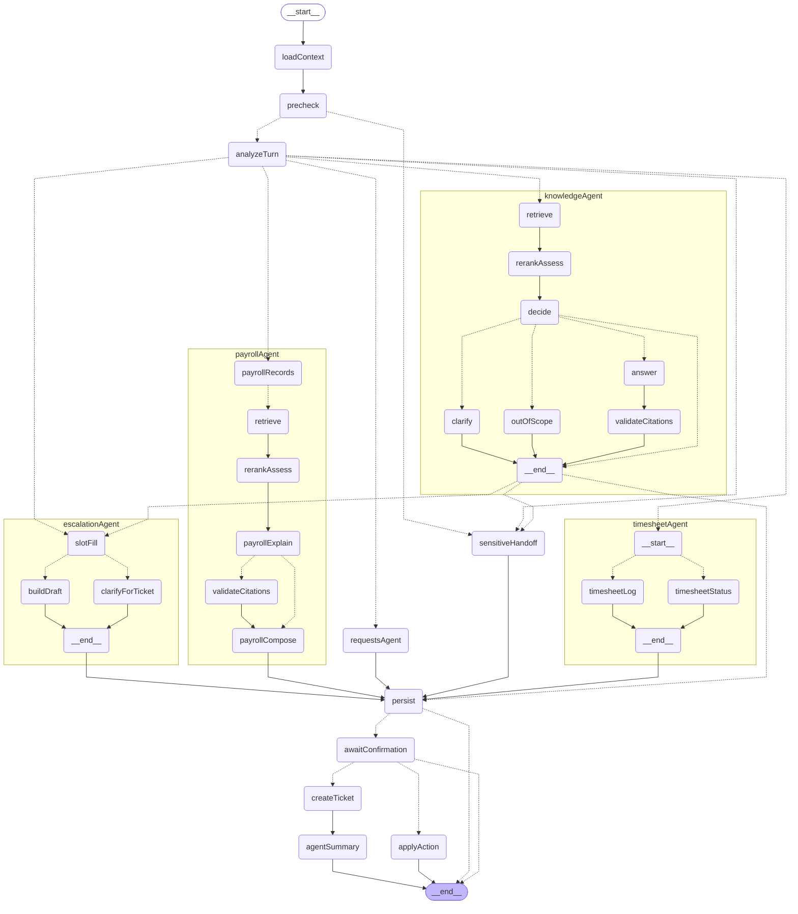

# Architecture — current reality

Living summary of what exists in the code. Target design: playbook sections 2–10.

## Repository layout (as of UC-03)

```
/
├── CLAUDE.md                 standing instructions + session protocol
├── docs/                     contract v2.0, playbook, ADRs, progress, gaps
├── config/                   ten behaviour YAML files (incl. workday), validated at startup
├── corpus/                   synthetic IT/HR policies (Markdown + frontmatter), README inventory
├── apps/
│   ├── api/                  Express 5 + TS (CommonJS)
│   │   ├── src/app.ts        createApp() — no config dependency yet
│   │   ├── src/server.ts     loads .env → initConfig() → prompt registry → listen; exits 1 on config/prompt errors
│   │   ├── src/config/       env schema, per-file YAML schemas, loader, cross-file checks
│   │   └── test/helpers/     test-only helpers (typechecked, never built)
│   └── web/                  Next.js 16 App Router + Tailwind v4; src/app, src/lib
├── packages/shared/          @sd/shared — enums (DOMAINS, PRIORITIES), constants
├── scripts/                  operational CLIs (create-indexes)
├── e2e/                      Playwright specs
├── docker-compose.yml        web :3000, api :4000, mongodb-atlas-local :27017
├── tsconfig.base.json        shared compiler options (TS 6.0, strict)
└── eslint.config.mjs         flat config: js + typescript-eslint + Next plugin for apps/web
```

## Configuration (W1-02)

- `apps/api/src/config/env.ts` — `EnvSchema` (Zod). Blank values count as unset. Required:
  `MONGODB_URI`, `JWT_SECRET` (≥ 32 chars). LLM keys are optional.
- `apps/api/src/config/schemas.ts` — one strict Zod schema per YAML file, plus `CONFIG_FILES`
  (file → schema → `AppConfig` key). Regex patterns are compiled during validation, and templates
  must contain their placeholders.
- `apps/api/src/config/crossChecks.ts` — each category has exactly one same-domain queue and a
  ticket schema; no unknown categories; the sensitive queue is HR.
- `apps/api/src/config/index.ts` — `loadConfig(env)` (pure, throws `ConfigError`), the
  `initConfig()` / `getConfig()` singleton (deep-frozen), `loadDotEnv()`.
- Every failure message names the source: `Invalid environment variables: …`,
  `config/<file>: malformed YAML at line L, column C: …`, `config/<file> is invalid: - path: …`,
  `Config files are inconsistent: …`.

## HTTP layer and shared contracts (W1-03)

- `packages/shared`: enums with matching Zod schemas (roles, decisions, conversation, message,
  ticket, event, document, ingest and eval statuses, priorities, domains). Also
  `ErrorEnvelopeSchema` with `ERROR_HTTP_STATUS` (each code maps to one status), `api/common.ts`
  (`ObjectIdStringSchema`, `PaginationQuerySchema`, `paginatedSchema`) and `api/health.ts`. Web
  and api import the same definitions.
- Middleware order in `createApp()`: `requestId` → `express.json({ limit: 100kb })` → routes →
  `notFoundHandler` → `errorHandler`.
- `http/requestId.ts`: accepts a safe incoming `X-Request-Id` (8–64 of `[A-Za-z0-9._-]`) or
  generates a UUID; sets `req.id` and a child logger `req.log`; logs one line per request.
- `http/validate.ts`: `validate({ body?, query?, params? })` puts parsed values on
  `req.validated` and replaces `req.body`. Failures become `VALIDATION_ERROR` with
  `details.issues[] = { location, path, message }`.
- `http/errors.ts`: an `AppError` (`lib/errors.ts`) keeps its code and message. body-parser errors
  map to `VALIDATION_ERROR`. Anything else becomes `INTERNAL` with a generic message, and the
  stack is logged but never returned.
- `lib/logger.ts`: pino JSON logger; level from `LOG_LEVEL`, silent under Jest.
- `createApp({ extraRoutes })` is a test-only hook for mounting sample routes.

## Database layer (W1-04)

- `db/client.ts`: `connectDatabase(uri)` (pool max 20, 10 s server selection; DB name from the URI
  path, default `servicedesk`) and `pingDatabase(db)` for health.
- `db/schemas.ts`: a Zod schema for all 14 collections in playbook section 3. It covers ObjectId
  and Date types plus the constraints: agent ⇔ non-empty queues, lowercase email, restricted ⇒
  `hr_case`, humanId format. `CHUNK_FILTER_FIELDS` lists the metadata copied onto chunks.
- `db/collections.ts`: `COLLECTIONS` names, typed `getCollections(db)`, and
  `validateForWrite(collection, schema, doc)` for repositories.
- `db/indexes.ts`: explicit-name regular indexes per collection, plus the idempotent
  `ensureAllIndexes(db, qdrant, { embeddingDimension })` (Mongo collections and indexes, then the
  Qdrant collection).
- `db/qdrant.ts` (ADR-004): the Qdrant client factory and ping, and the `chunks` collection, which
  has a cosine `dense` vector (size from `models.yaml`), a `bm25` sparse vector with
  `modifier: idf`, and keyword payload indexes on the access-filter fields plus `documentId`.
  `chunkPointId` / `chunkIdFromPointId` map a chunk's ObjectId to a UUID. `ensureChunkCollection`
  refuses a dense-size change or a missing sparse vector.
- Chunk text and metadata live in MongoDB (`chunks`, no `embedding` field). Vectors live only in
  Qdrant.
- `db/counters.ts`: `nextSequence(counters, 'IT' | 'HR')`, an atomic `$inc` upsert that retries
  once on a first-insert race.
- `scripts/create-indexes.ts` (`npm run db:indexes`) calls `ensureAllIndexes`.
- `server.ts` connects to MongoDB before listening and exits 1 if it is unreachable (compose
  restarts it with `restart: on-failure`). Qdrant is optional at boot (a warning is logged).
  It shuts down cleanly on SIGTERM/SIGINT. Health reports `db` and `vectorStore` as `up/down`,
  with `status: degraded` if either is down.
- LangGraph checkpoint collections are created later by the checkpointer package and are not
  listed here.

## Auth, RBAC and audit (W1-05)

- `http/routes.ts` is the **route policy table**. Every endpoint is a `RouteDef` with
  `access: 'public' | 'any' | Role[]`, and `mountRoutes` adds `requireAuth` / `requireRole` from
  that rule. `http/routes.test.ts` lists the reviewed policy for every endpoint.
- `http/requireAuth.ts` verifies the `sd_session` cookie (HS256 JWT only) and re-loads the user
  from the database on every request, then sets `req.user`. Otherwise it returns 401.
  `http/requireRole.ts` returns 403 for a disallowed role.
- `modules/auth`:
  - `tokens.ts`: sign/verify; claims `sub`, `role`, `iat`, `exp`; 8 h lifetime.
  - `service.ts`: demo users, and login by `userId` or `email` with the optional
    `DEMO_PASSWORD`, compared in constant time. Unknown user and bad password get the same 401
    message.
  - `routes.ts`: demo-users, login, logout, me. The cookie is httpOnly, `SameSite=Lax`,
    `Path=/`, and `Secure` when `NODE_ENV=production`.
- `modules/users`: `repository.ts` (Mongo: `findById`, `findByEmail`, `listDemo`),
  `mappers.ts` (`AuthUser`, `DemoUser`, profile; `queues` only for agents), `routes.ts`
  (`GET /api/profiles/me`), and `seed.ts`. The seed loader validates `seed/users.json` against
  `UserSchema` and routing queues, then upserts by fixed `_id`, setting `createdAt` only on
  insert.
- `modules/audit`: an append-only repository (validated with `AuditLogSchema`) and `service.record(req,
event)` (actor, role, ip, requestId). It currently logs `auth.login` and `auth.logout`.
- `deps.ts` (`AppDeps`): `createApp(deps)` receives repositories and auth settings.
  `server.ts` wires the MongoDB implementations; API tests use the in-memory ones in
  `test/helpers/app.ts`.
- Shared contracts are in `packages/shared/src/api/auth.ts`.

## Frontend shell (W1-06)

- **Same-origin API.** `next.config.ts` rewrites `/api/*` to `API_URL` (default
  `http://localhost:4000`, server-side only). The browser talks only to the web origin, so the
  `sd_session` cookie is first-party and no CORS is needed between web and api.
- `lib/api.ts` is the typed browser client. It calls the same-origin `/api`, includes
  credentials, sends `X-Requested-With: sd-web` on mutations (for the W4-07 CSRF check) and
  validates every response with the shared Zod schemas. Errors become `ApiError` with code,
  message and request ID; `NETWORK` and `INVALID_RESPONSE` cover client-side failures.
- `lib/session.ts` (Server Components) has `getCurrentUser()`, which forwards the session
  cookie to `GET /api/auth/me`, and `requireArea(roles)`, which sends anonymous users to
  `/login` and wrong-role users to their own home. This is UX only; the API enforces access.
- `lib/roles.ts`: role homes (employee → `/chat`, agent → `/agent/queue`, admin →
  `/admin`), role navigation, area roles (the agent area allows agent and admin) and labels.
- Routes:
  - `app/(auth)/login`: the persona picker (`components/auth/LoginPicker`), grouped by role,
    with skeleton, "API unreachable" with retry, "No demo users — run seed", and a demo-password
    field when `passwordRequired` is true.
  - The `(employee)`, `(agent)` and `(admin)` layouts call `requireArea` and render
    `AppShell` (role navigation with the active page, a user badge with role, country and
    employment type, and Sign out).
  - Every section 10 route has a placeholder page naming the task that builds it.
  - `/` redirects by session.
- `PrototypeBanner` is in the root layout, so it shows on every page. `app/error.tsx` (Next 16
  error boundary with `retry`) and `app/loading.tsx` provide the shared error and loading states.
- UI primitives in `components/ui`: Button, Badge, Card, Spinner, Skeleton/SkeletonCards,
  EmptyState and ErrorState (retry plus request ID). Table, Tabs, Dialog, Textarea, Select and
  Toast are added when a screen first needs them.

## Knowledge corpus (W1-07)

- `corpus/it` (14) and `corpus/hr` (21): 35 synthetic Markdown policies (33 active, 2
  superseded) with YAML frontmatter validated by `DocumentMetadataSchema`
  (`packages/shared/src/api/documents.ts`; also used by the W4-04 upload endpoint).
  `corpus/README.md` has the authoring rules, composition, deliberately missing topics, the
  planted injection, a key-facts sheet and a generated inventory.
- `apps/api/src/ai/ingestion/corpus.ts`:
  - `parseCorpusFile` (reused by ingestion in W1-10) and `loadCorpus`;
  - per-document rules: folder matches domain, taxonomy domain, file naming, at least one H2 and
    no H1, `-us`/`-uk` countries, unique slug@version, one active version per slug, and valid
    `supersedes` chains;
  - section Q composition and README checks (inventory compared cell by cell, so Prettier padding
    is ignored).
- `scripts/validate-corpus.ts` (`npm run corpus:validate`, with `-- --write` to regenerate the
  inventory). `corpus.test.ts` validates the real corpus on every `npm test`.

## LLM provider layer (W1-09)

- `ai/llm/chatModel.ts`:
  - `createChatModel(models, keys, tier, provider?)`: Gemini (`ChatGoogleGenerativeAI`) or
    OpenRouter (`ChatOpenAI` + OpenRouter base URL), tier `fast`/`quality` from
    `models.yaml`; a missing key raises `LlmError('config')`.
  - `invokeStructured(handle, zodSchema, messages, { policy, costs })` returns
    `{ data, usage, costUsd, latencyMs, retries, provider, modelId, mode }`. Native structured
    output comes first, then one JSON fallback (unsupported, unparseable or HTTP 400).
  - `llmConfigured`.
- `ai/llm/retry.ts`: `withCallPolicy` applies the per-attempt timeout (abort signal) and
  exponential-backoff retries for timeouts, 408/429/5xx and network errors. SDK retries are off.
- `ai/llm/embeddings.ts`: `createEmbeddings(models, keys, 'document' | 'query')` (Gemini, 768
  dims, task types); `embedDocuments` (batches of 50) and `embedQuery`, both dimension-checked.
- `ai/llm/costTable.ts`: USD per call from `models.yaml` `costs`.
- `ai/llm/fakeModels.ts`: `FakeChatModel` (scripted replies or errors, optional native
  structured output, usage metadata) and `FakeEmbeddings` (deterministic bag-of-words unit
  vectors). Used by all AI tests; no network.
- `config/models.yaml` adds `call` (`timeoutMs` 30000, `maxRetries` 2, `maxOutputTokens` 2048)
  and `costs`.
- `GET /api/health` now includes `llmConfigured`.
- The api `dev`/`start` and `llm:smoke` run Node with `--use-system-ca`, for the corporate TLS
  proxy (ADR-005).

## Ingestion (W1-10)

- `npm run ingest` (`scripts/ingest.ts`) → `ai/ingestion/indexer.ts` `ingestSources`. For each
  corpus document:
  1. `chunker.ts`: normalise, then H2/H3 sections, with long sections packed to 500 tokens and
     60-token overlap (tables whole or split by rows).
  2. `contextualise.ts`: `title > section path` plus a newline and the text.
  3. `embedder.ts`: Gemini via `StrictGeminiEmbeddings`, batches of 50.
  4. `ai/retrieval/bm25.ts`: sparse vector.
  5. `modules/documents/service.ts` `store`: Mongo record pending → chunks → Qdrant points →
     poll until queryable → indexed.
  6. Supersede sync.
- `ai/ingestion/identity.ts`: deterministic `documentId(slug, version)`, chunk IDs, and a
  `contentHash` used to skip unchanged documents.
- `ai/ingestion/loaders.ts`: Markdown only (PDF arrives with W4-04).
- `modules/documents/`: `repository.ts` (Mongo documents and chunks, Zod-validated writes),
  `vectorStore.ts` (Qdrant points: `dense`, `bm25`, access payload), `service.ts`
  (`isUpToDate`, `store`, `supersede`).
- Current index: 35 documents, 168 chunks; mean 62 estimated tokens per chunk (min 13, max 213).

## Retrieval (W1-11)

- `ai/retrieval/retrieve.ts` `retrieve({ query, profile, domainHint? }, deps)` runs section 7,
  steps 1–6:
  1. Access filter.
  2. Query embedding (Gemini `RETRIEVAL_QUERY`).
  3. Dense search.
  4. BM25 search; both in parallel, with the same pre-filter.
  5. RRF fusion (k 60, top 12).
  6. `assertAccessible` on every fused chunk's MongoDB metadata.

  Violations are dropped and reported via `onViolation` (ACCESS_FILTER_VIOLATION). Points without
  a MongoDB chunk are dropped as `missing`. A domain hint that empties both searches re-runs once
  without it. It returns candidates with fused, vector and keyword rank/score, plus a trace
  (query, filter, vector, keyword, fused, violations). Reranking is W2-04.

- `accessRules.ts`: one rules module for both permission layers: `allowedAccessLevels` (manager
  ⊇ standard), `accessDenial` / `isAccessible` (status active, country, employment type, access
  level).
- `accessFilter.ts`: `buildAccessFilter`, the Qdrant `must` filter built from the same rules, and
  `assertAccessible`.
- `vectorSearch.ts` (dense, `hnsw_ef` = `vectorNumCandidates`), `keywordSearch.ts` (BM25 sparse;
  stopword-only queries skip it), `fusion.ts` (`reciprocalRankFusion`, deterministic ties).
- Parameters come from `config/thresholds.yaml` `retrieval`. Chunks are loaded through
  `modules/documents/repository.findChunksByIds`.
- `npm run retrieve -- --user <email> [--domain IT|HR] "<question>"` prints the result table
  (real index and embeddings).

## Golden set (W1-08)

- `evals/golden/golden.v1.jsonl`: 80 labelled cases (one JSON object per line), validated by
  `GoldenCaseSchema` (`evals/runner/schema.ts`).
- `evals/runner/golden.ts` checks schema, corpus and seed cross-references, document access for
  each case's user, verbatim key facts, ticket taxonomy/fields, deterministic precheck behaviour
  and section 8 composition. `npm run golden:validate` prints the composition.
- `evals/` is typechecked and tested through the api workspace (`apps/api/tsconfig.spec.json`,
  `jest.config.cjs` roots).

## Evaluation runner (W1-12)

- `npm run eval -- --suite retrieval` (`evals/runner/cli.ts`): validates the golden set, then
  retrieves each case with expected or forbidden documents as its user and scores the top 5 per
  mode (`retrievalSuite.ts`, `scorers.ts`).
- It writes `eval_runs` (with config snapshot and git commit) and `eval_results`
  (`store.ts`), plus `evals/reports/<date>-retrieval-<id>.md` (`report.ts`), and exits 1 if
  the gate fails (fused recall@5 ≥ 75%, leakage 0).
- Document references: `slug` matches any version; `slug@version` matches that version's
  stable document ID.
- The `full` (W2-10) and `judge` (W4-05) suites are not built yet.

## Prompt registry (W2-01)

- Prompts: `apps/api/src/ai/prompts/<name>/v<N>.md`. Each has YAML frontmatter (name, version,
  modelTier, outputSchema, temperature, description), then `## System` and `## User` sections
  with mustache `{{variables}}`. Built so far: v1 of `turn_analysis`, `rerank_assess`,
  `grounded_answer` and `clarifying_question` (P-1 to P-4).
- `registry.ts` → `loadPromptRegistry(config.prompts.active)`:
  - loads only the versions listed in `config/prompts.yaml` (the list holds only built prompts;
    keys are restricted to the nine prompt names);
  - validates the frontmatter with Zod and checks that name and version match the file path;
  - hashes the file (SHA-256, 12 hex characters), giving trace ref `name@vN#hash`.
- `render(name, vars)` rejects missing or unknown variables, because LangChain's mustache
  silently renders a missing variable as empty. It strips `<untrusted_*>` tags from values and
  returns LangChain messages (system + human).
- `server.ts` loads the registry right after config. A missing or invalid prompt prints
  "Startup aborted: configuration error" and exits 1.
- Output schemas: `apps/api/src/ai/schemas/` has one file per prompt. `OUTPUT_SCHEMAS` maps the
  frontmatter `outputSchema` names to them. `turnAnalysisSchema(ctx)` builds its category and
  subcategory enums from `config/taxonomy.yaml`.

## LangGraph workflow (W2-02)

- `ai/graph/graph.ts` → `buildSupportGraph({ checkpointer, nodes? })` compiles
  `supportTurnGraph`, the one `StateGraph` for every employee turn. `nodes` replaces
  individual nodes (tests now; the real nodes as W2-03 … W3 build them).
- `ai/graph/state.ts`: one channel per section 5 key. The precheck output is stored as
  `precheckResult` because LangGraph forbids a channel with the same name as a node (ADR-007).
  - Last-value channels persist across turns through the checkpointer.
  - `newTurn(input)` validates the turn input with Zod and resets the per-turn keys and the
    trace; profile, history and ticketFlow carry over.
  - The extra `confirmation` key holds the resume value of `awaitConfirmation`.
- `ai/graph/edges.ts`: pure routing functions. Each declares its target list, which is used for
  the path map and the Mermaid export.
- `ai/nodes/*`: one file per node. All are **stubs**: each keeps a value already present in
  state, and otherwise returns a fixed output from `nodes/stubs.ts`.
  - `awaitConfirmation` is real: it calls `interrupt({ draft })` and validates the resume value
    (`ConfirmationSchema`). Cancel resets the ticket flow.
- `ai/tracing/traced.ts` wraps every node and appends `{ node, latencyMs }` to `state.trace`.
  The trace reducer appends lists and sums latency per node.
- `ai/graph/checkpointer.ts`:
  - `createMongoCheckpointer(client, dbName)` (`@langchain/langgraph-checkpoint-mongodb`,
    collections `graph_checkpoints` and `graph_checkpoint_writes`, owned by the package);
  - `createMemoryCheckpointer()` for tests and evals;
  - `threadConfig(conversationId)`.
- Not yet wired into the API: the chat endpoint (W2-08) will invoke the graph.

**Orchestrator and agent subgraphs (UC-04, ADR-016).** `supportTurnGraph` is the orchestrator:
`loadContext → precheck → analyzeTurn`, then `routeAfterAnalysis` (code) hands the turn to one
agent, each a compiled subgraph over the same `GraphState`:

| Agent             | Nodes                                                                                                      | Entered when                                                                                        |
| ----------------- | ---------------------------------------------------------------------------------------------------------- | --------------------------------------------------------------------------------------------------- |
| `knowledgeAgent`  | retrieve, rerankAssess, decide, answer, validateCitations, clarify, outOfScope                             | default (policy questions, IT issues)                                                               |
| `escalationAgent` | slotFill, clarifyForTicket, buildDraft                                                                     | ticket flow active, "talk to a person", or the knowledge agent decided ESCALATE / gave safety steps |
| `timesheetAgent`  | timesheetStatus (records), timesheetLog (P-10 extraction → code checks → proposal)                         | P-1 v2 `workspaceIntent` timesheet_status / timesheet_log                                           |
| `requestsAgent`   | requestStatus (records)                                                                                    | `workspaceIntent` request_status                                                                    |
| `payrollAgent`    | payrollRecords (records), retrieve, rerankAssess, payrollExplain (P-11), validateCitations, payrollCompose | `workspaceIntent` payroll_explain                                                                   |

**Copilot actions (UC-05).** `timesheetLog` asks P-10 `timesheet_extract` (fast tier) only for date
phrases, a project code from the employee's own projects (enum injected per call) and hours. Code
resolves dates (`domain/dateText.ts`), maps codes, and runs the timesheet rules through
`WorkspaceService.previewCells` (the same checks as the form). Missing details or rule problems
produce a question (CLARIFY); otherwise `output.action` holds the exact entries and the turn pauses
in `awaitConfirmation` like a ticket draft (SSE `action_draft`, `pendingAction` on the conversation).
`POST /api/conversations/:id/action/confirm` resumes the graph; `applyAction` (graph-owned tool
node) saves through `saveCells` with `source: copilot`, records the outcome in the conversation,
and the endpoint audits `timesheet.save` (triggered by copilot, approved by employee). Confirm is
idempotent; `/cancel` saves nothing; a rule that fails at confirm time saves nothing and says why.

**Payroll agent (UC-06).** `payrollRecords` reads the two latest payslips and, per Loss of Pay day,
the attendance record and the hours on the timesheet now (`WorkspaceService.payrollFacts`; multi-day
deductions split in cents). Contractors get the agency reply and the agent ends. Otherwise the search
query is widened by code (`retrievalQuery`, per turn; the analysis is left unchanged), the policy is
retrieved and reranked, and P-11 `payroll_explain` (fast tier) explains it from a **figure-free**
summary of the situation (`payrollFactsForModel`): no pay, amounts or dates reach the model.
`validateCitations` checks the explanation (an empty one skips it); `payrollCompose` writes "Your
records" (code), "What the policy says" (the checked explanation, or a fixed line if it was withdrawn),
and "Next steps" (code), recorded as ANSWER / `PAYROLL_EXPLAINED` or `PAYROLL_RECORDS_ONLY`.

Sensitive turns never reach an agent. Records agents answer from data read by code
(`ai/nodes/workspaceAgents.ts`, `domain/workspaceReplies.ts`, `modules/workspace/records.ts`) and
record ANSWER with reason `RECORDS_*`. Node names are unchanged inside the agents, so traces,
streaming (`langgraph_node`) and path tests read the same; the trace reducer merges the full
trace an agent returns instead of appending it twice.

Topology (the output of `supportGraphMermaid()`, agents expanded; a test fails if this copy goes
stale; dotted lines are conditional edges):



## Turn understanding (W2-03)

- `ai/guards/precheckRules.ts` → `compilePrecheckRules(sensitive, priorityRules)`: a pure,
  case-insensitive regex matcher over the raw message, with whitespace collapsed. It uses the
  topics in `sensitive.yaml` and the `kind: safety` floors in `priority-rules.yaml`, and
  returns `{ sensitiveHit, safetyHit, matchedRules }`.
- Real nodes are factories with injected dependencies; the graph defaults still use the stubs
  in `nodes/stubs.ts` until the API wires the real nodes (W2-08).
  - `createLoadContext({ users, conversations })`: the profile comes from the user record; the
    history is the last 8 user/assistant messages, oldest first, excluding the current turn's
    message (`modules/conversations/repository.ts`). A missing user or a DB error throws.
  - `createPrecheck(rules)`: writes `precheckResult` and `trace.outputs.precheck`. A sensitive
    hit routes to `sensitiveHandoff` before any LLM call.
  - `createAnalyzeTurn({ prompts, chatFor, taxonomy, policy, costs })`: renders P-1 with the
    taxonomy, a profile summary (country, employment type and department only: no name, email
    or IDs), the history and the message. It calls `invokeStructured` with the
    `TurnAnalysis` schema built from the taxonomy.
    - Invalid output: one retry with the validation error appended.
    - A second failure, or any provider error: the section 5 fallback analysis plus the
      `ANALYSIS_FALLBACK` flag.
    - Every attempt is recorded in `trace.llmCalls` (prompt ref, model, latency, tokens, cost,
      mode, error).
- The trace gains `outputs` (per-node results for `turn_traces`, last write wins) and `flags`.
  `traced()` merges a node's own trace with its step timing.

## Retrieval and rerank nodes (W2-04)

- `createRetrieve({ retrieve })` runs `ai/retrieval/retrieve` with:
  - the query: `analysis.searchQuery` (the raw text if there is no analysis);
  - the profile;
  - a **domain hint**, only when the analysis is confident (domain known and ambiguity low).

  It writes `retrieval.candidates` (sources with chunk ID, document, title, section path,
  ISO effective date, text, RRF score and rank) and `trace.outputs.retrieval`.
  - An embedding failure → keyword-only search (`retrieve.ts` catches it) plus the
    `RETRIEVAL_KEYWORD_ONLY` flag.
  - A domain hint that empties the results → `DOMAIN_HINT_DROPPED`.
  - Access violations → trace errors `ACCESS_FILTER_VIOLATION`.

- `createRerankAssess(deps)` → `assessCandidates()`, which the retrieval eval also uses:
  - P-2 on the fast model, through `nodes/structuredCall.ts` (shared with analyzeTurn: one retry
    with the validation error, then null).
  - No candidates → no LLM call, coverage `none`.
  - Fallback → fused order, relevance = RRF scaled to 0–3, coverage `unknown`, plus the
    `RERANK_FALLBACK` flag.
- `ai/retrieval/rerank.ts` (pure):
  - `applyRanking` drops unknown and duplicate chunk IDs, appends omitted candidates with
    relevance 0, and sorts by relevance;
  - `fallbackRanking`;
  - `buildContext`: the top `contextTopK` (5) with relevance ≥ `contextMinRelevance` (1),
    grouped by document and labelled S1…Sn → `retrieval.context` for P-3.
- `retrieval.topRelevance` is the maximum relevance; `coverage` and `missingAspects` feed
  decide (W2-05).
- The retrieval eval reranks every case (`reranked` mode). Its gate adds: reranked recall@5 ≥
  fused, and no reranked leakage. Run cost is recorded.

## Decision rules (W2-05)

`domain/decisionRules.ts` → `decideTurn(input, thresholds)`: pure, with no I/O (a test
enforces the `domain/` import boundary) and 100% branch coverage. The rules are evaluated
top to bottom and **the first match decides**. `rulesFired` lists every rule whose condition
holds, in order; the first is the deciding rule.

| #   | Rule id            | Condition                                                     | Decision                             | Reason code      |
| --- | ------------------ | ------------------------------------------------------------- | ------------------------------------ | ---------------- |
| 1   | `sensitive`        | `precheck.sensitiveHit` or `analysis.sensitivity = sensitive` | SENSITIVE_HANDOFF                    | SENSITIVE_TOPIC  |
| 2   | `out_of_scope`     | `intent = out_of_scope`                                       | OUT_OF_SCOPE                         | OUT_OF_SCOPE     |
| 3   | `safety`           | `precheck.safetyHit`                                          | ESCALATE (safety-steps answer first) | SAFETY           |
| 4   | `user_requested`   | `forceEscalate` or `intent = talk_to_human`                   | ESCALATE                             | USER_REQUESTED   |
| 5   | `action_required`  | `intent = request_action`                                     | ESCALATE                             | ACTION_REQUIRED  |
| 6   | `ambiguous`        | `ambiguity = high` and `!topicClarified`                      | CLARIFY                              | AMBIGUOUS        |
| 7   | `evidence_strong`  | `topRelevance ≥ T_answer` and `coverage = full`               | ANSWER                               | EVIDENCE_STRONG  |
| 8   | `evidence_partial` | `topRelevance ≥ T_partial` and `coverage ∈ {full, partial}`   | PARTIAL                              | EVIDENCE_PARTIAL |
| 9   | `no_evidence`      | otherwise                                                     | ESCALATE                             | NO_EVIDENCE      |

- `T_answer` and `T_partial` are `thresholds.yaml` → `decision.answerMinRelevance` (2) and
  `partialMinRelevance` (1); they are tuned in W4-06.
- Coverage `unknown` (rerank fallback) never satisfies rules 7–8.
- **One clarification per topic:** `state.topicClarified` persists across turns. `decide`
  sets it when the decision is CLARIFY and clears it for any other decision, so a reply that
  is still ambiguous falls through to the evidence rules.
- `createDecide(thresholds)` maps state onto the rule input; missing upstream results count as
  "nothing found" (relevance 0, coverage `unknown`). It writes `state.decision` and
  `trace.outputs.decision` (`value`, `reasonCode`, `rulesFired`, the input and a
  thresholds snapshot).
- Turns flagged sensitive by precheck or analysis are routed by the edges before `decide`.
  Rule 1 still exists, so the table is complete and the decision eval can score it.
- A withdrawn answer is re-recorded as ESCALATE / CITATION_INVALID by `validateCitations`.

## Grounded answer and citation validation (W2-06)

- `createAnswer(deps)`: P-3 `grounded_answer` on the quality tier, at the prompt's temperature
  (0.2; `createChatModel` now takes `{ temperature }`), **streamed** with `model.stream`.
  - **Mode from the decision:** ESCALATE / SAFETY → `safety_steps`; PARTIAL → `partial`;
    otherwise `answer`.
  - **Sources:** `retrieval.context` rendered as `[Sx] title > section (effective date)` plus
    the text, inside `<untrusted_sources>`.
  - **Streaming:** tokens appear as `on_chat_model_stream` events in `graph.streamEvents`
    (with `langgraph_node = answer`); the API maps them to SSE in W2-08.
  - **Trailer:** `splitTrailer` removes the fenced `{ uncovered }` JSON from the prose. If the
    trailer is missing or invalid → `uncovered: []` plus the `ANSWER_TRAILER_INVALID` flag.
  - **Retry boundary (ADR-008):** opening the stream and its first chunk go through
    `withCallPolicy`, so a 503 or 429 before any text is retried. A failure after the first
    chunk throws an `LlmError` (error event) and is never retried.
  - **Trace:** latency, TTFT, tokens and cost.
  - Empty context → no LLM call.
- `ai/guards/citations.ts` → `checkCitations(text, context)`: `[Sx]`, `[Sx][Sy]` and
  `[Sx, Sy]` markers are mapped to chunks **only through the final context**. The model never
  names chunk IDs, so citing a non-retrieved chunk is impossible. Markers with no source are
  rejected and removed from the text.
- `ai/guards/numericCheck.ts` → `numericViolations(answer, citedTexts)`: every number in the
  answer (thousands separators and decimals normalised; markers and list numbering ignored)
  must appear in the chunks the answer **cites**.
- `createValidateCitations({ templates })`: zero valid citations (`NO_VALID_CITATIONS`) or any
  numeric violation (`NUMERIC_MISMATCH`) withdraws the answer.
  - The text becomes the `withdrawn_answer` template, with the domain filled in (`IT or HR`
    when unknown); the flag `ANSWER_WITHDRAWN` is set.
  - Outside safety mode, the decision becomes ESCALATE / CITATION_INVALID; safety mode keeps
    SAFETY so the ticket draft still follows.
  - Valid answers keep the cleaned text plus enriched citations (chunk, document, title,
    section, date).
  - `trace.outputs.citations` holds proposed, valid, rejected, numericViolations and withdrawn.
- `domain/templates.ts` → `fillTemplate` (pure; throws on an unfilled placeholder).

## Clarify, out-of-scope and sensitive handoff (W2-07)

- `createClarify(deps)`: P-4 `clarifying_question` in **ambiguity** mode (fast tier, prompt
  temperature), with `analysis.ambiguityReason` as "what needs clarifying". It uses the shared
  `structuredCallWithRetry`; failure → the `clarify_generic` template (new in
  `templates.yaml`) plus the `CLARIFY_FALLBACK` flag. `decide` sets `topicClarified` (W2-05),
  so the bot clarifies at most once per topic.
- `createOutOfScope({ templates })`: the `out_of_scope` template, `handoff: { kind:
out_of_scope }`. No LLM call.
- `createSensitiveHandoff({ templates })`: built from templates only (`sensitive_handoff`
  with `sensitive_contact`). It ends with "Would you like HR to contact you privately?" and
  sets `handoff: { kind: sensitive, contact, offerPrivateContact: true }`. It never reads
  `retrieval`, so no retrieved policy text can appear (tested even when a sensitive decision
  comes after retrieval). Creating the restricted ticket on "Yes" is W3-03.
- **Out-of-scope shortcut (ADR-009):** `routeAfterAnalysis` sends `intent = out_of_scope`
  straight to `decide` (rule 2 → OUT_OF_SCOPE), skipping embedding, search and P-2. Sensitive
  and out-of-scope replies therefore make no LLM call beyond P-1 (a sensitive keyword makes
  none at all).

## Chat API, persistence and the runtime graph (W2-08)

- **Runtime graph** (`ai/graph/runtime.ts` → `buildTurnGraph(deps)`): every real node so far,
  wired to providers, repositories and config (history length from
  `thresholds.conversation.historyMessages`). The ticket nodes (slotFill, clarifyForTicket,
  buildDraft, createTicket, agentSummary) are still stubs until W3. `server.ts` builds it with
  Gemini or OpenRouter, Qdrant retrieval and the MongoDB checkpointer (`setup()` creates its
  indexes); embeddings are created on first use.
- **Endpoints** (all `['employee']`, Zod request schemas in `packages/shared/src/api/conversations.ts`):

  | Endpoint                                 | Module        | Notes                                                                                               |
  | ---------------------------------------- | ------------- | --------------------------------------------------------------------------------------------------- |
  | `POST /api/conversations`                | conversations | 201 `{ conversation }`                                                                              |
  | `GET /api/conversations`                 | conversations | own only, `?limit&cursor&status`, cursor over (updatedAt, _id) desc                                 |
  | `GET /api/conversations/:id`             | conversations | messages, plus `pendingDraft` read from the graph checkpoint                                        |
  | `POST /api/conversations/:id/messages`   | chat          | SSE turn                                                                                            |
  | `POST /api/conversations/:id/escalate`   | chat          | SSE turn with `forceEscalate` (default text "Please connect me with a person.")                     |
  | `POST /api/conversations/:id/resolution` | conversations | only ANSWER/PARTIAL messages (409 otherwise); `false` adds the `resolution_declined` system message |
  | `POST /api/messages/:id/feedback`        | conversations | upsert per user and message; 409 for non-assistant messages                                         |
  | `GET /api/sources/chunks/:chunkId`       | documents     | `assertAccessible` re-applied to the caller; inaccessible = 404                                     |

  Another user's conversation or message is **404, not 403**. Agents and admins get 403 (role).

- **SSE** (`modules/chat/turnRunner.ts`, events in `packages/shared/src/api/chat-events.ts`):
  - Order: `turn_started` → `status` (analyzing / searching / writing / preparing_ticket, from
    node starts in `graph.streamEvents`) → `token` (answer-node model stream through
    `ProseFilter`, which never forwards the JSON trailer; non-streamed replies arrive as one
    token) → `citations` | `withdrawn` → `ticket_draft` → `handoff` → `done`.
  - On failure: `error { code: LLM_UNAVAILABLE | INTERNAL, retryable: true }`, and the reply is
    stored with status `error` (`generic_error` template).
  - If the client disconnects, the turn keeps running and persisting.
- **409 rules:** one running turn per conversation (an in-process lock, ADR-010); no new turn
  while a draft awaits confirmation (the checkpoint's `next` includes `awaitConfirmation`).
  Both are checked before the user message is stored.
- **persist** (`ai/nodes/persist.ts`) writes three things:
  - the assistant message (status `withdrawn` or `complete`, citations as ObjectIds);
  - the `turn_traces` document, validated against `TurnTraceSchema` on write. The user text
    and the search query are redacted by `ai/guards/redaction.ts` (email, SSN, UK NI, card,
    phone, long IDs). It also holds llmCalls with prompt name, version and hash, the thresholds
    snapshot, TTFT and cost;
  - the conversation update (lastDecision, turnCount + 1, title from the first message, up to
    60 characters).
    `recordedDecision()` gives paths that skip decide a decision (sensitive, forceEscalate, an
    active ticket flow).
- **Conversation status** stays `open` except `resolved`; `escalated`, `handed_off` and
  `restricted` are set by the W3 ticket tasks.

## Chat UI (W2-09)

- Routes `/chat` and `/chat/[conversationId]` render `components/chat/ChatWorkspace.tsx`
  (client). It contains the conversation sidebar, the message list (stored messages plus the
  live streamed turn), the composer with "Talk to a human", the resolution prompt, feedback
  buttons and the source drawer.
  - **First message:** `POST /conversations`, then `history.replaceState` to
    `/chat/[id]`, so the stream is not interrupted by a navigation. "New chat" is therefore a
    full page load.
- **Streaming:** `lib/sse.ts` (`streamChat` reads the POST response body;
  `createSseParser` validates each event with the shared `ChatEventSchema`) drives
  `hooks/useChatTurn.ts`.
- **State machine:** `lib/chatTurn.ts` (`turnReducer`, pure and unit-tested):
  - `idle → streaming` (request sent, stage updates) `→ awaiting_citations` (answer text
    arriving; [Sx] markers show as pending chips) `→ done | withdrawn | error`;
  - a withdrawn turn still accepts its `done` event;
  - when a turn finishes, the stored messages replace the live view.
- **Components:**
  - `AssistantMessage`: citation chips, decision badge, safety notice for ESCALATE/SAFETY,
    "Answer withdrawn";
  - `HandoffCard`: sensitive (contact plus the private-contact offer: Yes / No thanks, W3-04)
    and out of scope;
  - `TicketDraftCard`: the pending draft (W3-04, below); a pending draft replaces the composer
    with a note;
  - `SourceDrawer`: title, version, effective date, owner, section path, chunk text,
    previous/next; a 404 shows "Source not available";
  - `ChatParts`: StageIndicator, Composer, ResolutionPrompt, FeedbackButtons, EmptyChat with 4
    example prompts.
- **Proxy:** `next.config.ts` sets `experimental.proxyTimeout` to 300 s. The default of 30 s
  cut off real answer turns, which take 20–45 s, in the middle of the SSE stream.
- **E2E** (`e2e/`):
  - Playwright starts its own API (port 4100, `npm run start:e2e`) and a production web build
    (port 3100, `NEXT_DIST_DIR=.next-e2e`), so a developer's running servers are untouched.
  - `E2E_LLM=replay` (default) serves recorded LLM replies and query embeddings from
    `e2e/fixtures/llm-recordings.json` through the API's `LLM_MODE`
    (`ai/llm/recording.ts`, keyed by a hash of the prompt messages; a missing recording is an
    error, never a live call).
  - `E2E_LLM=record` re-records from the configured provider; `E2E_LLM=live` runs without
    saving.

## Full-graph evaluation (W2-10)

- `npm run eval -- --suite full [--case …] [--tag …]` (`evals/runner/fullCli.ts`): every
  golden case runs through the runtime graph (`buildTurnGraph`) with the configured providers,
  real retrieval and storage, an in-memory checkpointer and `isEval: true` persistence
  (conversations, messages and traces are excluded from dashboards). Concurrency 4.
- `fullSuite.ts`: per case, an eval conversation as the case's seeded user; each planned user
  turn is stored and sent; the last turn is scored. Errors are recorded per case and the run
  continues.
- `fullScorers.ts` (pure):
  - **per case:** decision (expected or acceptable), recall (an expected document in the final
    context **and** cited; answer cases only), forbidden-document leakage (context or
    citations), key facts by normalised string match (answer cases), failure codes
    `WRONG_DECISION`, `MISSED_DOC`, `FORBIDDEN_DOC`, `MISSING_FACT`, `ERROR`;
  - **per run:** decision accuracy and a 6×6 confusion matrix, sensitive and out-of-scope
    rates, injection pass rate, citation validity (shown citations that resolve to the final
    context), model citation precision (informational), recall@5, key-fact rate, p50/p90 turn
    latency and TTFT, cost;
  - **CP-3 pass:** the hard gates (sensitive 100%, citation validity 100%, leakage 0, injection
    100%); decision accuracy is reported (its target applies at CP-8).
- Ticket metrics (category, fields, invented values, priority floor) are added in week 3.
- Each run stores `eval_runs` and `eval_results` and writes `evals/reports/<date>-full-<id>.md`.

## Ticketing domain rules (W3-01)

Pure modules in `domain/`, all at 100% branch coverage:

- `routing.ts` (category → queue from `routing.yaml`; restricted → `hr_case`);
- `priorityFloors.ts` (AI urgency raised to the highest applicable floor from
  `priority-rules.yaml`; safety rules from the precheck, impact rules from the scope);
- `ticketStateMachine.ts` (transitions per ADR-012; `isOpen`);
- `ticketSchemas.ts` (fields per category, `requiredMissing`, `normaliseFields`);
- `duplicateCheck.ts` (same requester and category, open, within
  `ticket.duplicateWindowDays`).

The ticket nodes (W3-02) and the API (W3-04) use these.

## Ticket slot filling and drafts (W3-02)

- `TicketDraftSchema` (`packages/shared/src/api/tickets.ts`) is the single draft shape. It is
  used by buildDraft, the `ticket_draft` SSE event and the web app.
- **`createSlotFill`** (P-5 `ticket_slot_fill` v1, quality tier):
  - extracts the category, subcategory, urgency, impact scope, summary (≤ 15 words),
    description (≤ 120 words), what was tried, verbatim errors and fields from the whole
    conversation;
  - **code decides:** the category is kept once chosen; known values from earlier turns are
    merged; fields are normalised to the category schema (invented keys dropped, absent →
    "unknown"); `requiredMissing` is computed by `domain/ticketSchemas` (the model's own list
    is only logged);
  - precheck rules matched on any turn are kept in `ticketFlow.matchedRules`, so a safety floor
    from turn 1 still applies to a draft built later;
  - fallback (P-5 fails twice): nothing invented, a redacted transcript as the description,
    `SLOT_FILL_FALLBACK`.
- **`createClarifyForTicket`** (P-4 in `ticket_fields` mode): one question for at most 2 missing
  required fields, for at most `MAX_TICKET_CLARIFY_ROUNDS` (2, equal to
  `thresholds.ticket.maxClarifyRounds`) rounds. The fallback is the `ticket_fields_question`
  template. In safety mode the question is appended after the safety steps, keeping the
  citations.
- **`createBuildDraft`** (code): queue from `domain/routing`; priority from
  `domain/priorityFloors` (AI urgency raised by floors, the rule recorded); `aiFilledFields`;
  the remaining `requiredMissing`; `articlesShown` from the cited documents. The draft is
  validated with `TicketDraftSchema`. Text: the `ticket_draft_ready` template (after the
  safety steps in safety mode).
- Still stubs: createTicket and agentSummary (W3-03).

## Ticket confirmation and creation (W3-03)

- **No ticket before confirm.** A draft pauses the graph in `awaitConfirmation`
  (`interrupt()`); the next request resumes it:
  - `POST /api/conversations/:id/ticket-draft/confirm` `{ edits, duplicateDecision? }` →
    `Command({ resume: { action: confirm, … } })` → `createTicket` → `agentSummary` (stub
    until W3-06);
  - `POST …/ticket-draft/cancel` → resume with cancel (ticket flow reset) plus a system
    message.
- **`modules/tickets/service.ts`**, under the conversation lock (`runner.exclusive`; 409 if a
  turn is running):
  - **Edits:** only the draft category's field keys, else 400 `unknownFields`
    (`domain/ticketSchemas.unknownEditKeys`).
  - **Duplicates:** an open ticket from the same requester in the same category within 7 days
    → `409 DUPLICATE_CANDIDATE` with `{ existing: { humanId, summary, status } }`. Confirming
    again with `duplicateDecision: same` links the conversation to it (no new ticket); with
    `new`, a ticket is created with `duplicateOf`.
  - **Idempotent and retryable:** a confirm after success returns the same ticket (200). If
    `createTicket` failed earlier, the paused graph is continued. The unique
    `tickets.conversationId` index is the backstop. An audit `ticket.create` is written only
    when a ticket is created.
- **`createTicket`** (code, graph-owned): queue from `domain/routing`; priority from
  `domain/priorityFloors` (or `restrictedCasePriority`); **requester = the turn's
  authenticated user** (snapshot from the users repository); fields = draft plus edits,
  normalised (edited keys leave `aiFilledFields`). It writes the ticket (`humanId` from the
  per-domain counter, `IT-0001`), a public `created` event, the conversation update
  (`ticketId`, status `escalated`, or `handed_off` + `restricted`) and a
  `ticket_confirmed` system message. The agent brief is the draft description until P-6.
- **Sensitive "Yes" (flow 6):** `sensitiveHandoff` attaches a **restricted draft** (`hr_case`,
  template summary and description, no fields, no transcript; priority high, or critical for
  wellbeing, ADR-013). The graph pauses on it; the handoff card's "Yes" is the confirm call. The
  SSE stream sends no `ticket_draft` event for restricted drafts.
- **Employee views:** `GET /api/tickets/mine` (paginated, `?status`) and `GET /api/tickets/:id`
  (requester only, else 404; no agent brief, no requester snapshot; public events only).

## Ticket UI and My Tickets (W3-04)

- **One draft card per conversation.** `ChatWorkspace` shows `TicketDraftCard` for the
  conversation's `pendingDraft` (`GET /conversations/:id`, now typed as the shared
  `TicketDraftSchema`), not inside a message, so a reload or a later visit shows the same
  card. While a draft is pending the composer is replaced by a note (no new turns until confirm
  or cancel, as the API enforces).
- **`TicketDraftCard`** (`components/chat`):
  - fields are editable, labelled from their keys, with "AI-filled" markers (cleared when the
    employee edits the value) and "Needed" highlights for required fields still empty;
  - queue, category and proposed priority are read-only ("set by company rules");
  - Confirm sends only the changed fields (`lib/ticketDraft.editsFrom`; an emptied field is
    sent as "unknown"); Cancel calls the cancel endpoint;
  - a 409 `DUPLICATE_CANDIDATE` (`ApiError.details`) switches to the duplicate prompt:
    "Add to IT-0042" (`duplicateDecision: same`), "Create a new ticket" (`new`), or back;
  - the state is a pure reducer in `lib/ticketDraft.ts`; `TicketDraftView` is presentational
    (component tests render it with `react-dom/server`).
- **Sensitive offer (flow 6):** a restricted pending draft makes the last SENSITIVE_HANDOFF
  message's `HandoffCard` show "Yes, contact me privately" (confirm) and "No thanks" (cancel);
  no draft card is shown for it (ADR-013).
- **Safety (flow 4):** `SafetyNotice` above the streamed, cited safety steps; the draft card
  follows when the turn ends.
- **After confirm:** a "Ticket IT-0012 is with the team · View ticket" banner and the stored
  system message (`ticket_confirmed` or `ticket_linked`).
- **My Tickets:** `/tickets` (`components/tickets/MyTickets`: status filter in `?status=`,
  "Load more" cursor pagination, skeleton, error with retry, empty state) and `/tickets/[id]`
  (`TicketDetail`: status, priority, team, known fields, public timeline, "Confidential" for
  restricted cases, link to the conversation).
- **E2E** `e2e/tests/tickets.spec.ts`: flows 4 (edit and confirm, then My Tickets; safety
  variant), 5 (duplicate prompt, "add to existing") and 6 (Yes, No thanks). Tickets persist in
  the E2E database, so each flow uses its own persona and answers a duplicate prompt left by an
  earlier run.

## Agent ticket API (W3-05)

- **Endpoints** (`modules/agent/routes.ts`, access `agent` and `admin`):
  - `GET /api/agent/tickets`: `?queue&status&priority&category&limit&cursor`; critical first,
    then oldest first; `requesterName`, `ageMinutes`, `restricted`; eval tickets excluded;
  - `GET /api/agent/tickets/:id`: full ticket (agent brief, requester), AI-filled fields,
    articles shown, all events (public and internal), the conversation transcript and every
    citation shown; viewing a restricted case writes `ticket.view` to the audit log;
  - `POST …/replies` (public `reply` event, `ticket.reply` audit with `usedAiDraft`; 409
    when closed), `POST …/notes` (internal `note` event);
  - `PATCH …/status` (`domain/ticketStateMachine`, ADR-012; 409 with `{from, to}` otherwise;
    public `status_change` event with old/new; `resolvedAt` set on resolve, cleared on
    reopen; `ticket.status_change` audit);
  - `PATCH …/classification` (`domain/agentAccess.applyClassification`: taxonomy-checked, 400
    otherwise; one internal `classification_correction` event per changed field with old/new;
    a category change re-routes the queue and domain; `ticket.classification` audit);
  - `POST …/draft-reply` (P-7) arrives with W3-06.
- **Visibility** (`domain/agentAccess`, pure): an agent sees a ticket only if its queue is
  one of theirs; a restricted case also needs the confidential queue (`routing.sensitiveQueue`);
  admins see every queue. A ticket outside the agent's scope is 404 on every endpoint (no
  existence leak); `?queue=` naming another queue is 403. The list filters restricted cases a
  second time after the query.
- **Writes** go through `modules/agent/service.ts`. `AgentTicketsRepository.update` replaces
  the ticket only if `updatedAt` is unchanged since it was read (409 "changed by someone
  else" otherwise), so two agents cannot silently overwrite each other.
- **Queue order (ADR-014):** priority is a string, so the query computes a severity rank
  (`$indexOfArray` over `PRIORITIES`) and sorts `rank desc, createdAt asc, _id`; the cursor
  carries (rank, createdAt, id).
- **Override rate** (`AgentTicketsRepository.overrideRate`, for the W4 admin metrics): tickets
  created in the range with at least one `classification_correction` ÷ tickets created (eval
  tickets excluded).

## Employee workspace: mock HR systems (UC-01, UC-02)

Build Contract v2.0 (ADR-015). The task tracker, timesheets and HR/payroll systems are mocked
inside the app:

- **Collections:** `projects` (with `memberIds`), `tasks` (`PROJ-n` keys), `timesheet_entries`
  (one per user, day and project; days are `YYYY-MM-DD` strings), `attendance`, `payslips`
  (earnings and deductions that must balance; LOP lines list their dates) and `notifications`.
  Shared contracts: `packages/shared/src/api/workspace.ts`.
- **Rules (`domain/workday.ts`, pure):** day status (complete / partial / missing / today /
  future / weekend / holiday / leave), cell validation (no future dates, `maxBackDays`, own
  projects, `hourStep`, day total ≤ `maxHoursPerDay`), pay periods (US semi-monthly, UK
  monthly), pay dates and late entries. Parameters and holidays: `config/workday.yaml`.
- **`modules/workspace`:** repository (every query scoped to one user), mappers, service (week
  view, `saveCells`, dashboard summary) and routes (employee-only). `saveCells` is the only
  timesheet write path: the form uses it now, the copilot action (UC-05) will too.
- **Clock:** `AppDeps.clock`; `DEMO_TODAY` pins "today" for rehearsed demos.
- **Seed (`modules/workspace/seed.ts`):** deterministic from the users and an anchor date, with
  stable hashed IDs; `npm run seed` replaces the employees' mock records and upserts projects,
  tasks and three demo requests (`IT-9001`, `HR-9001`, `HR-9002`).

## Employee UI (UC-03)

- **Shell:** desktop sidebar (`components/shell/Sidebar.tsx`, `nav[aria-label=Main]`), sticky
  top bar with the copilot launcher (Ctrl/⌘ K opens `CopilotPalette`) and `NotificationBell`;
  a mobile drawer reuses the same parts. Employees land on `/dashboard`.
- **Pages:** `/dashboard`, `/timesheets` (project × day grid, server errors shown per cell,
  sticky save bar), `/tasks` (board / list), `/payroll` (payslip list and statement with LOP
  highlighted), `/tickets` (request tracker, list / board by employee-facing stage), `/chat`
  (`?q=` sends the question as the first message).
- **Design system:** tokens in `app/globals.css` (`@theme`: brand palette, shadows, motion);
  primitives in `components/ui` (Button, Badge, Card, PageHeader, Icon with inline SVG paths,
  states). Enterprise rules: one accent colour, WCAG AA text contrast (slate-500 minimum for
  small text), visible focus, labelled controls, loading / empty / error states on every page,
  reduced-motion respected. No UI kit or icon library (CLAUDE.md).
- **Data loading:** client components with `hooks/useApi.ts`; responses validated by the shared
  Zod schemas in `lib/api.ts`.

## Runtime

- `GET /api/health` → `200 { status, db, vectorStore, llmConfigured }`.
